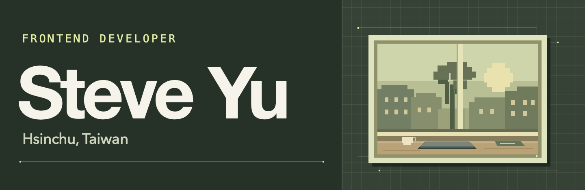
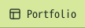
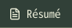
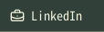
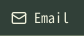
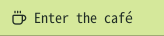
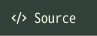
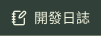

# 

I build interactive websites and reusable UI with TypeScript.

  
  
  
  

## Steeport

**A walkable 3D café in your browser.** Start at the window seat, open a book, or build a reading room next door. You can switch camera views mid-visit and the book you left open stays open.

| At the window | Overhead pixel view |
| --- | --- |
|  |  |

Three.js · TypeScript · Blender

  
  
  

## More frontend projects

### [Notion Kit ↗](https://github.com/steeeee0223/notion-kit)

An unstyled React component registry for building Notion-style interfaces, including a database table.

### [Code Sandbox ↗](https://github.com/steeeee0223/steeeee-sandbox)

A browser code editor with CodeMirror, resizable panels, and a live preview powered by Sandpack.

[Browse all repositories ↗](https://github.com/steeeee0223?tab=repositories)
